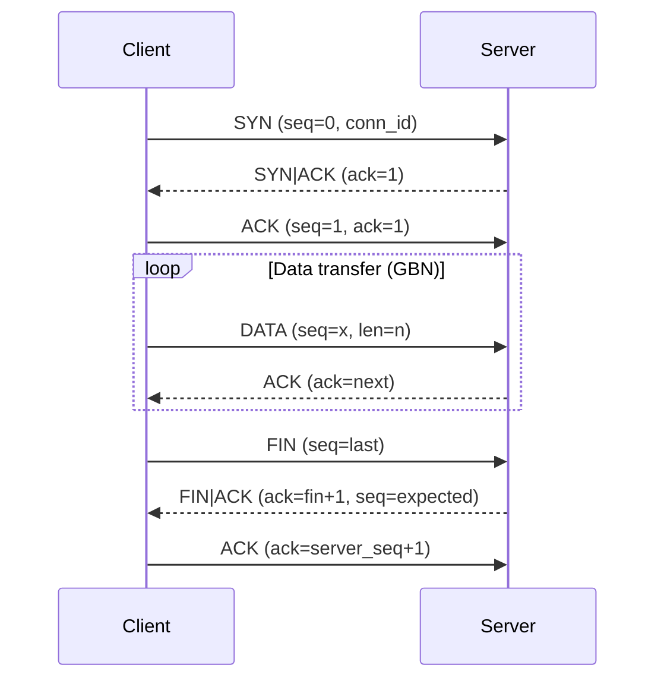
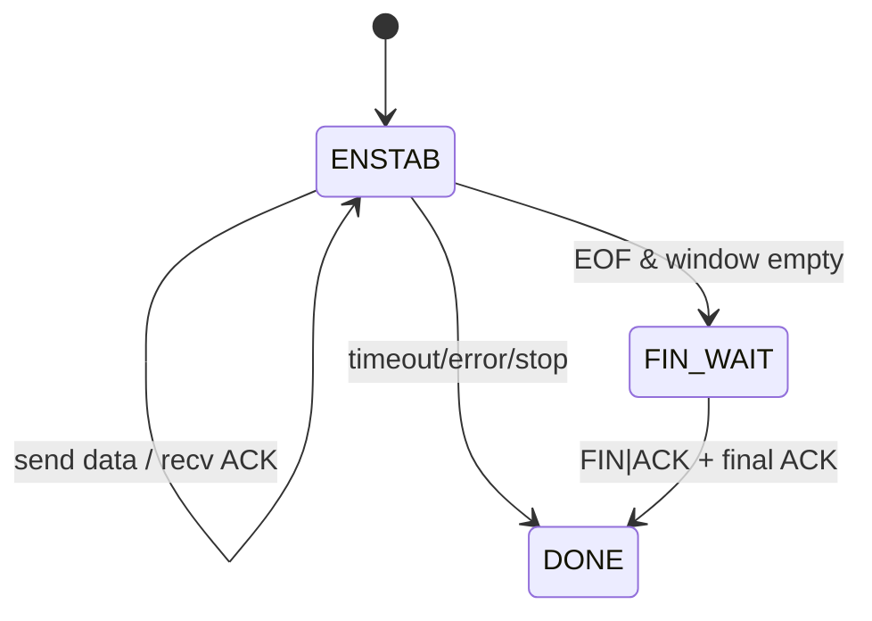
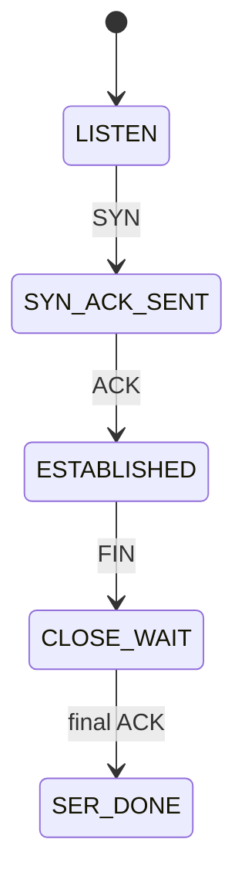

# IPK Project 2 – Reliable File Transfer over UDP

Implementácia prenosu jedného súvislého byte streamu nad UDP podľa zadania IPK2. Projekt obsahuje jediný binárny program `ipk-rdt`, ktorý vie fungovať ako klient aj server a realizuje vlastný spoľahlivý transportný protokol inšpirovaný TCP (Go-Back-N).

## Build

```sh
make
```

Vyčistenie:

```sh
make clean
```

## Spustenie

Server:

```sh
./ipk-rdt -s -p PORT [-a ADDRESS] [-o OUTPUT] [-w TIMEOUT]
```

Klient:

```sh
./ipk-rdt -c -a HOST -p PORT [-i INPUT] [-w TIMEOUT]
```

Príklady:

```sh
./ipk-rdt -s -p 9000 -o received.bin
./ipk-rdt -c -a 127.0.0.1 -p 9000 -i sample.bin
```

```sh
./ipk-rdt -s -p 9000
printf 'IPK\n' | ./ipk-rdt -c -a 127.0.0.1 -p 9000
```

## Návrh protokolu

### Formát hlavičky
Každý UDP datagram nesie jednu jednotku protokolu (max. 1200 B). Hlavička je pevná (18 B) a je v sieťovom byte order (big-endian).

| Pole | Veľkosť | Popis |
| --- | --- | --- |
| `conn_id` | 4 B | Identifikátor spojenia (náhodne generovaný klientom) |
| `seq_num` | 4 B | Sekvenčné číslo prvého bajtu payloadu |
| `ack_num` | 4 B | Kumulatívne potvrdenie – ďalší očakávaný bajt |
| `data_len` | 2 B | Dĺžka payloadu |
| `flags` | 1 B | SYN/ACK/FIN/RST |
| `reserved` | 1 B | rezervované (0) |
| `checksum` | 2 B | ones’ complement checksum hlavičky+payloadu |

Max. payload = 1200 - 18 = **1182 B**.

### Identifikácia spojenia
- `conn_id` generuje klient náhodne pri štarte.
- Server akceptuje iba pakety s daným `conn_id` a z adresy klienta, ktorý dokončil handshake.

### Establishment a termination
Použitý je 3-way handshake a explicitné ukončenie (FIN/ACK).



### Sekvenovanie a ACK
- Sekvenčné čísla sú **bajtové** (nie segmentové).
- `ack_num` je kumulatívne potvrdenie „next expected byte“.
- Prenos dát začína od `seq=1` (0 je rezervované pre SYN).

### Okno a pipelining
- Go-Back-N s pevnou veľkosťou okna **16 segmentov**.
- V jednom okamihu môže byť v lete max. 16 neacknutých segmentov.
- Pri výpadku ACK sa retransmitujú všetky neacknuté segmenty v okne.

### Retransmisia a timeouty
- Interný retransmit interval: **200 ms** (`RETRANSMIT_MS`).
- `-w TIMEOUT` určuje maximálny čas bez protokolového progresu.
- Progres = nové potvrdenie alebo nový in-order payload.
- Pri prekročení `TIMEOUT` sa proces ukončí s nenulovým exit kódom.

### Duplikáty a reordering
- Server prijíma len segment s `seq_num == expected`.
- Out-of-order alebo duplicitné segmenty sa ignorujú, ale odosiela sa kumulatívny ACK (aktuálne `expected`).
- Klient ignoruje duplicitné ACK (nižšie ako aktuálna báza okna).

### Kontrola integrity
- Checksum = ones’ complement cez celý paket (hlavička + payload).
- Pakety s nesprávnou checksum alebo nesprávnou dĺžkou sa zahadzujú.

### UML stavové diagramy

#### Klient


#### Server


## Testovanie

### Ako spustiť automatické testy

```sh
make test
```

Testy sú definované cez CTest (`ipk-tests`). Jednotlivé prípady sa dajú spustiť napríklad:

```sh
ctest --test-dir build -R basic_file_transfer
```

### Testovacie prostredie
- OS: Ubuntu 24.04.4 LTS
- Kernel: Linux 6.17.0-1010-azure
- GCC: 13.3.0
- Topológia: localhost (loopback)

### Pokrytie a výsledky

| Test | Čo sa testuje | Prečo | Ako | Vstup / očakávaný výstup | Skutočný výsledok |
| --- | --- | --- | --- | --- | --- |
| `basic_file_transfer` | prenos súboru → súbor | základná funkčnosť | klient+server na IPv4 | 64 KiB náhodných dát, výstup totožný | **PASS** (exit 0, obsah zhodný) |
| `stdin_stdout_transfer` | `stdin` → `stdout` | podpora streamov | client stdin, server stdout | 8 KiB náhodných dát | **PASS** (exit 0, obsah zhodný) |
| `empty_input_transfer` | prázdny vstup | edge-case | prenos 0 B | očakáva sa prázdny výstup | **PASS** |
| `cli_invalid_args` | chybné argumenty | validácia CLI | spustenie bez povinných arg. | nenulový exit | **PASS** |
| `client_timeout` | timeout bez servera | správne ukončenie | klient na neexistujúci port | nenulový exit po `-w 1` | **PASS** |
| `prehandshake_garbage` | garbage pred handshake | robustnosť | UDP garbage pred SYN | prenos stále korektný | **PASS** |
| `ipv6_transfer` | IPv6 prenos | IPv6 podpora | ::1 loopback | 16 KiB náhodných dát | **PASS** |
| `netem_impairments` | strata/reordering/duplikácia | odolnosť | proxy (drop/dup/delay) | 32 KiB náhodných dát | **PASS** |

Poznámka: `netem_impairments` používa user-space proxy, ktorá:
- zahodí každý 10. dátový paket,
- oneskorí každý 7. dátový paket o ~80 ms,
- duplikuje každý 13. dátový paket.

## Merané správanie

Meranie na localhoste (IPv4, bez impairmentov):
- Veľkosť dát: 16 MiB
- Čas prenosu: **0.7 s**
- Priepustnosť: **~22.86 MiB/s**

Meranie na localhoste (IPv4, bez impairmentov):
- Veľkosť dát: 16 MiB
- Čas prenosu: **0.8 s**
- Priepustnosť: **~20 MiB/s**

## Známe obmedzenia
- Žiadne congestion control a adaptívne RTT (fixné retransmit intervaly).
- Server nezapamätáva out-of-order segmenty (očakáva GBN od klienta).
- Jedno spojenie na proces (žiadny multi-client server).
- Bez šifrovania a autentizácie.

## Zdroje
- RFC 768 (UDP)
- RFC 793 / RFC 9293 (TCP)
- RFC 6298 (RTO)
- KUROSE, ROSS: Computer Networking: A Top-Down Approach